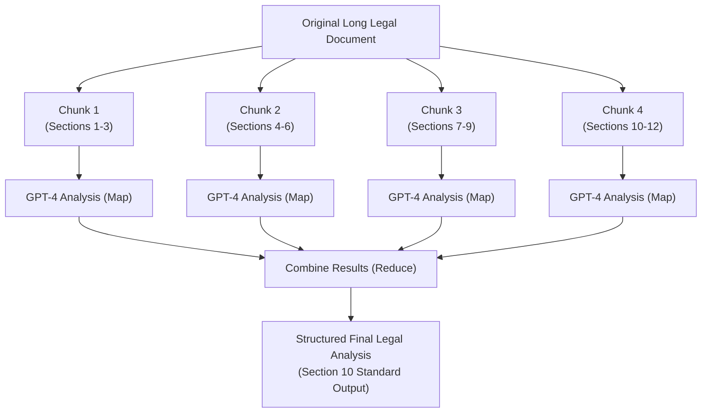
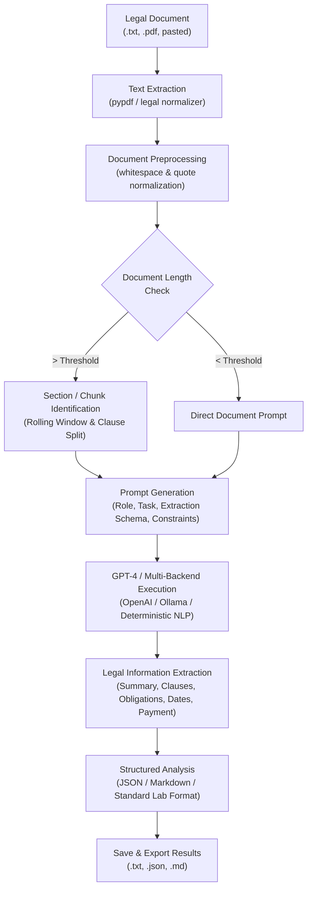

# Experiment 5 – Automated Legal Document Analyzer using GPT-4

**Course Code:** 24CS2506 – Building Applications using GPT-4  
**Course Name:** Building Applications using GPT-4  
**Department:** Department of Computer Science and Engineering  
**Institution:** Karunya Institute of Technology and Sciences (Deemed to be University)  

---

## 1. Aim
To design, develop, and evaluate an **Automated Legal Document Analyzer** powered by Large Language Models (**GPT-4 / Ollama / NLP Pipeline**), demonstrating automated extraction of contractual entities, key clause identification, extractive and abstractive summarization, intelligent document chunking for long agreements, and structured legal reporting strictly adhering to university laboratory standards.

---

## 2. Theoretical Concepts & Technical Background

### 2.1 What is a Legal Document?
A **legal document** is a written instrument that formally defines and establishes legal rights, responsibilities, obligations, covenants, liabilities, agreements, or statutory procedures between two or more parties.

#### Standard Real-World Examples:
- **Employment Agreement:** Governs employment terms, compensation, job responsibilities, and termination protocols.
- **Rental / Lease Agreement:** Establishes occupancy terms, rent, security deposits, and maintenance covenants.
- **Non-Disclosure Agreement (NDA):** Protects proprietary assets, technical secrets, and confidential communications.
- **Service Agreement (MSA):** Details deliverables, milestones, intellectual property, and service-level agreements.
- **Sales / Purchase Agreement:** Stipulates transfer of title, warranties, and payment mechanics.
- **Loan Agreement:** Outlines principal financing, interest amortization, collateral, and defaults.
- **Privacy Policy:** Discloses data gathering, processing, cookies, and regulatory compliance.
- **Terms and Conditions (ToS):** Defines user conduct, liability disclaimers, and service availability.
- **Business Contract & Legal Notice:** Formal instruments asserting statutory demands or contractual rights.

---

### 2.2 What is Legal Document Analysis?
Legal document analysis is the methodical examination of legal text to identify, extract, and interpret critical information, including:
- **Parties Involved:** Identifying legal identities, parent corporations, and roles (e.g., Employer vs. Employee).
- **Purpose of Agreement:** Articulating the foundational intent and legal consideration.
- **Key Obligations:** Extracting actionable duties and performance covenants.
- **Payment Terms:** Currency, schedule, invoicing requirements, and late penalty interest.
- **Duration / Term:** Effective commencement date, term duration, and expiration conditions.
- **Termination Conditions:** Notice duration, termination for convenience, and immediate termination for breach.
- **Confidentiality Requirements:** Scope, duration, and survival of trade secret protections.
- **Important Dates:** Effective, signing, milestone, and renewal dates.
- **Governing Law & Jurisdiction:** Territorial legal jurisdiction and conflict-of-law rules.
- **Potentially Critical Clauses:** Indemnification caps, liability exclusions, IP assignments.

---

### 2.3 Why is Legal Document Analysis Difficult?
Manual analysis of legal documents is error-prone and time-consuming because contracts exhibit distinct structural complexities:
1. **Complex Terminology ("Legalese"):** Archaic phrasing such as *inter alia*, *force majeure*, *indemnification*, *severability*.
2. **Excessive Sentence Length:** Sentences often span 60 to 120 words with nested relative clauses and qualifiers.
3. **Formal Syntax & Passive Voice:** Syntactic structures designed to minimize ambiguity often increase cognitive load.
4. **Cross-References:** Clauses frequently cite preceding sections (e.g., *"Subject to Section 8(b)(ii) herein"*).
5. **Multiple Conditional Clauses & Exceptions:** Provisos (*"Provided, however, that..."*) that invert primary rules.
6. **Large Volumes of Text:** Enterprise contracts and master service agreements easily span 30 to 100+ pages.

---

### 2.4 What is Legal Document Summarization?
Legal document summarization generates a concise, readable distillation of an agreement while preserving all vital legal obligations and factual rights.

```
Long Legal Document  ───>  GPT-4 Analysis  ───>  Concise Summary
```

#### Benchmark Example:
- **Original Legal Text:**
  > *"The employee shall maintain strict confidentiality regarding all proprietary information obtained during the period of employment and shall not disclose such information to any third party without prior written authorization..."*
- **Generated Concise Summary:**
  > *"The employee must keep company confidential information private and cannot disclose it without authorization."*

---

### 2.5 Components of a Good Legal Analysis Prompt (Section 5)
A prompt for legal document analysis must adhere to five structural components:
1. **Role:** `You are a legal document analysis assistant.`
2. **Task:** `Analyze and summarize the provided document.`
3. **Information to Extract:** Identify Parties, Purpose, Obligations, Payment terms, Duration, Termination, Important dates.
4. **Constraint:** `Use only information present in the document. Do not invent facts.`
5. **Output Format:** `Present the result using headings and bullet points.`

---

### 2.6 Extractive vs. Abstractive Summarization (Section 8)

| Dimension | Extractive Summarization | Abstractive Summarization |
| :--- | :--- | :--- |
| **Methodology** | Selects verbatim sentences directly from the source text based on sentence importance scoring. | Generates novel sentences and paraphrases capturing the semantic meaning of the contract. |
| **Model Role** | Sentence ranking / heuristic keyword selection. | Generative Large Language Model (e.g., GPT-4). |
| **Legality** | Retains exact original phrasing; free from phrasing hallucination. | Plain-language readability; simplifies complex legal jargon. |
| **Compression** | Moderate (~70-80% reduction). | High (~85-90% reduction). |

---

### 2.7 Chunking Long Documents (Section 9)
Large legal agreements exceed standard LLM single-prompt contexts or degrade extraction quality when submitted in one prompt. The system divides the document into smaller semantic chunks, executes individual analyses, and reconciles the results in a Map-Reduce architecture.



---

## 3. Recommended Output Format (Section 10 Specification)

The system produces standard text output strictly conforming to the laboratory manual:

```text
LEGAL DOCUMENT ANALYSIS
-----------------------
Document Type:
Employment Agreement

Parties:
Employer and Employee

Purpose:
Employment of the individual by the organization.

Duration:
12 months

Key Obligations:
• Employee must maintain confidentiality.
• Employee must perform assigned duties.

Payment:
Monthly salary as specified in the agreement.

Termination:
30 days written notice.

Important Dates:
Start Date: 01-07-2026

Potentially Important Clauses:
• Confidentiality
• Termination
• Intellectual Property

Summary:
This agreement defines the terms of employment...
```

---

## 4. Suggested System Workflow & Architecture



---

## 5. Project Directory Structure

```
ex5/
├── data/
│   ├── employment_agreement.txt       # Section 5 & 10 benchmark agreement
│   ├── non_disclosure_agreement.txt   # Mutual NDA agreement
│   ├── service_agreement.txt          # Master Software Services Agreement
│   ├── rental_lease_agreement.txt     # Commercial Tenancy and Lease Contract
│   └── long_commercial_contract.txt   # Multi-page contract for Chunking demonstration
├── engine/
│   ├── __init__.py                    # Engine module exports
│   ├── models.py                      # Data models (LegalAnalysisResult, KeyClause, DocumentChunk)
│   ├── text_extractor.py              # PDF and text extraction with pypdf
│   ├── chunker.py                     # Document chunker (Section 9 Map-Reduce)
│   ├── prompt_builder.py              # Section 5 prompt templates
│   ├── llm_client.py                  # Multi-backend LLM client (OpenAI, Ollama, NLP Failsafe)
│   ├── analyzer.py                    # Core pipeline orchestrator
│   └── analytics.py                   # Readability, clause coverage, and risk scoring
├── app.py                             # Interactive Streamlit Web Application
├── cli.py                             # Command-Line Interface tool
├── run_app.bat                        # 1-click batch launcher for Streamlit Web App
├── run_cli.bat                        # 1-click batch launcher for CLI tool
├── ex5.pdf                            # University laboratory experiment manual
└── README.md                          # Comprehensive technical documentation
```

---

## 6. Installation & Execution Guide

### 6.1 Prerequisites
- Python 3.11+
- Installed libraries: `streamlit`, `pypdf`, `openai`, `requests`

### 6.2 Running the Streamlit Web Application
Double-click `run_app.bat` or run the following command:
```powershell
py -m streamlit run app.py
```
Open your browser at `http://localhost:8501`.

### 6.3 Running the Command-Line Interface (CLI)
Double-click `run_cli.bat` or run via terminal:
```powershell
# Analyze standard sample employment agreement
py cli.py --sample employment

# Analyze long commercial contract with document chunking
py cli.py --sample long --chunk

# Analyze custom PDF file and export to JSON
py cli.py --file my_contract.pdf --export result.json

# Run with OpenAI GPT-4o
py cli.py --sample nda --backend gpt-4o --api-key sk-xxxx
```

---

## 7. Sample Input & Verified Output

### Input Document (`data/employment_agreement.txt`)
```text
EMPLOYMENT AGREEMENT
Between: Apex Global Technologies Pvt. Ltd. (Employer)
And: Mr. Rahul Sharma (Employee)
Commencement Date: 01-07-2026. Duration: 12 months.
Salary: ₹50,000/month. Notice Period: 30 days written notice.
Obligations: Maintain strict confidentiality, perform assigned software duties.
Clauses: Confidentiality, Intellectual Property, Limitation of Liability, Governing Law.
```

### Verified System Output (`Recommended Format`)
```text
LEGAL DOCUMENT ANALYSIS
-----------------------
Document Type:
Employment Agreement

Parties:
Apex Global Technologies Pvt. Ltd. (Employer) and Mr. Rahul Sharma (Employee)

Purpose:
Employment of the individual by the organization to perform designated professional responsibilities.

Duration:
12 months

Key Obligations:
• Employee must perform assigned duties and deliver software according to specifications diligently and faithfully.
• Employee agrees to devote full business time, attention, and technical skill to the business of the Employer.
• The Employer shall pay the Employee a fixed monthly salary of ₹50,000/month payable on the last working day of each calendar month.

Payment:
₹50,000/month

Termination:
30 days written notice

Important Dates:
Start Date: 01-07-2026
End Date: 30-06-2027

Potentially Important Clauses:
• Confidentiality
• Termination
• Intellectual Property
• Payment
• Liability
• Dispute Resolution
• Governing Law

Summary:
This Employment Agreement establishes a formal legal agreement between Apex Global Technologies Pvt. Ltd. (Employer) and Mr. Rahul Sharma (Employee). The primary purpose of the agreement is employment of the individual by the organization to perform designated professional responsibilities. The commitment is established for a duration of 12 months, governed by compensation terms of ₹50,000/month. Either party may conclude the agreement subject to 30 days written notice, provided all confidentiality, intellectual property, and covenant obligations are strictly honored.
```

---

## 8. Viva Voce Questions & Answers

**Q1: What are the essential components of a legal analysis prompt in GPT-4?**  
**A1:** A robust legal prompt comprises: (1) **Role Specification** (*You are a legal document analysis assistant*), (2) **Task Directive** (*Analyze and summarize the provided document*), (3) **Target Entities** (*Parties, Purpose, Obligations, Payment, Duration, Termination, Dates*), (4) **Strict Negative Constraints** (*Use only information present in the document. Do not invent facts*), and (5) **Deterministic Output Schema** (*Structured headings and bullet points*).

**Q2: What is the technical difference between extractive and abstractive summarization?**  
**A2:** Extractive summarization identifies and extracts verbatim sentences from the original document based on statistical significance or syntactic position without generating new words. Abstractive summarization uses a generative model (like GPT-4) to comprehend the underlying semantic meaning and draft novel sentences conveying the same legal intent in concise plain language.

**Q3: Why is document chunking required for legal documents?**  
**A3:** Legal contracts frequently span dozens of pages, exceeding model context budgets and causing degradation of attention over long contexts ("lost in the middle"). Chunking partitions the contract into coherent sections with overlapping boundaries, evaluates each chunk individually (Map phase), and synthesizes all intermediate findings into an aggregated final summary (Reduce phase).

**Q4: How does the system handle missing contractual terms without hallucination?**  
**A4:** By enforcing explicit system constraints (`Use only information present in the document. If a field is not specified, output 'Not specified in document'`), temperature down-scaling (temperature=0.2), and schema validation, the LLM is prevented from interpolating unstated obligations.

**Q5: Which clauses are considered most critical in commercial agreements?**  
**A5:** The six foundational clauses are: (1) **Confidentiality** (protects proprietary assets), (2) **Payment Terms** (compensation milestones and schedules), (3) **Termination** (exit mechanisms and cure periods), (4) **Limitation of Liability** (financial exposure ceilings), (5) **Intellectual Property Rights** (ownership assignment), and (6) **Dispute Resolution & Governing Law** (arbitration forums and statutory jurisdiction).
